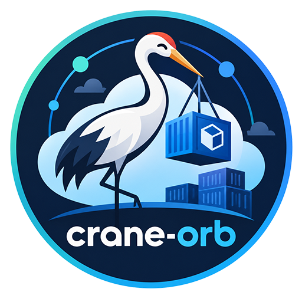
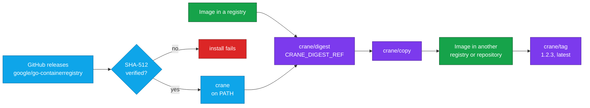

<div align="center">



# Crane Orb for CircleCI

### Copy, tag and inspect container images in their registries, straight from CircleCI.

Install a checksum-verified [crane](https://github.com/google/go-containerregistry/tree/main/cmd/crane) and work on images where they live:<br>
promote a build between registries, mirror a base image, add release tags, or pin a tag to its digest.<br>
No Docker daemon · Strict SHA-512 verification by default · No `sudo` · Passwords never on the command line

[](https://circleci.com/gh/juburr/crane-orb)
[](https://circleci.com/developer/orbs/orb/juburr/crane-orb)
[](LICENSE)
[](https://discuss.circleci.com/c/ecosystem/orbs)


**[Quick Start](#-quick-start)** · **[Features](#-why-crane-orb)** · **[Recipes](#-recipes)** · **[Commands](#-commands)** · **[Security](#-secure-by-design)** · **[Network Access](#-network-access)**

<sub>An unofficial, community-maintained orb. [Contributions are welcome!](#-contributing)</sub>

</div>

<br>

## ✨ Why crane-orb?

<table>
<tr>
<td width="33%" valign="top">
🚚 <b>Registry to registry, no daemon</b><br><br>
<code>copy</code> moves an image between repositories or registries directly, with every platform of a multi-platform image and its digest unchanged. No <code>docker pull</code>, <code>docker tag</code> and <code>docker push</code> round trip, and it runs on a Docker executor without <code>setup_remote_docker</code>.
</td>
<td width="33%" valign="top">
🏷️ <b>Release tags in seconds</b><br><br>
<code>tag</code> writes an existing image's manifest under new tags, such as <code>1.2.3</code> and <code>latest</code>, without moving a single layer.
</td>
<td width="33%" valign="top">
🔗 <b>Digests for later steps</b><br><br>
<code>digest</code> reads what a tag points to right now and exports <code>CRANE_DIGEST</code> and <code>CRANE_DIGEST_REF</code>, so later steps can copy, sign, scan or deploy exactly that image, even if the tag moves.
</td>
</tr>
<tr>
<td width="33%" valign="top">
🔐 <b>Verified installs, fail-closed by default</b><br><br>
By default, every crane binary is checked against a SHA-512 table built into the orb, and versions it can't verify are refused, not run. <a href="#-checksum-verification">Opt-outs</a> are explicit.
</td>
<td width="33%" valign="top">
🔑 <b>Secrets stay off the command line</b><br><br>
Credential parameters name environment variables. The password reaches crane on stdin, so it never shows up in a process listing or the step log, even with xtrace on.
</td>
<td width="33%" valign="top">
🦾 <b>amd64 and arm64</b><br><br>
Picks the right crane build for x86_64 executors and CircleCI Arm resource classes, cached per version and architecture.
</td>
</tr>
</table>

### 🧩 The Orb vs. a Hand-Rolled Script

| | Scripting crane yourself | With the orb |
| --- | --- | --- |
| **Installing crane** | Download the go-containerregistry release from GitHub, check it against the release's checksums, extract `crane` from it, and put it on the `PATH` | `crane/install` checks the binary against a built-in SHA-512 for amd64 and arm64, fails closed on unknown versions, caches the release, and adds `install_path` to the `PATH` when it isn't there |
| **Registry login** | Pipe the password to `crane auth login --password-stdin`, and keep a traced step from printing it | `login` reads the variables you name and does both |
| **Pinning a tag to its digest** | Capture `crane digest` output, build the `repo@digest` reference, and export both to later steps | `digest` exports both, shell-quoted, through `BASH_ENV` |
| **Several tags at once** | Loop over `crane tag`, one tag per call, and hope none is mistyped halfway through | `tag` checks every tag first, then adds them in order |

## 🔄 How It Works



`crane/install` downloads crane straight from the [go-containerregistry releases on GitHub](https://github.com/google/go-containerregistry/releases), verifies the SHA-512 checksum of its `crane` binary in the default `strict` mode shown here, and puts it on `PATH`. See [Checksum Verification](#-checksum-verification) for the other modes. `crane/login` stores credentials for a registry, `crane/digest` pins a tag to what it points to now, `crane/copy` copies the image, and `crane/tag` adds tags to it. `crane/logout` removes the credentials when the job is done with them.

## 🚀 Quick Start

Add the orb, install crane, promote an image. Copy this into `.circleci/config.yml`:

```yaml
version: 2.1

orbs:
  crane: juburr/crane-orb@0.1.0

jobs:
  promote:
    docker:
      - image: cimg/base:current-22.04
    steps:
      - crane/install:
          version: "0.22.1"
      # Reads the credentials from REGISTRY_USERNAME and REGISTRY_PASSWORD.
      - crane/login:
          registry: ghcr.io
      - crane/digest:
          image: ghcr.io/my-org/myapp-staging:${CIRCLE_SHA1}
      - crane/copy:
          source: ${CRANE_DIGEST_REF}
          destination: ghcr.io/my-org/myapp:${CIRCLE_SHA1}
      - crane/tag:
          image: ghcr.io/my-org/myapp@${CRANE_DIGEST}
          tags: 1.2.3 latest
      - crane/logout:
          registry: ghcr.io

workflows:
  release:
    jobs:
      - promote:
          context: registry-credentials
```

Swap in your registry and repositories, put `REGISTRY_USERNAME` and `REGISTRY_PASSWORD` in the `registry-credentials` context (for GHCR, your GitHub username and a token that can write packages), and run it. `digest` pins the staging tag to the image it points to right now, `copy` copies exactly that image, and `tag` adds the release tags to the copy, which keeps the source's digest. No step needs a Docker daemon, so this runs on a plain Docker executor.

> [!IMPORTANT]
> This orb is at 0.x, so a minor release may still change a command or parameter. Pin the orb version, and the crane `version` as shown, so neither changes until you decide.

## 🍳 Recipes

### Mirror a Public Base Image

Copy a public image into your own registry, every platform at once, so your builds don't depend on the public registry's availability or pull limits. The source needs no login:

```yaml
steps:
  - crane/install:
      version: "0.22.1"
  - crane/login:
      registry: registry.example.com
  - crane/copy:
      source: mirror.gcr.io/library/alpine:3.20
      destination: registry.example.com/base-images/alpine:3.20
  - crane/logout:
      registry: registry.example.com
```

Set `platform` to copy one platform of a multi-platform image, such as `linux/amd64`. The copy is then that platform's image, with that platform's digest. To never overwrite a tag that already exists in the destination, pass `extra_args: --no-clobber` (crane 0.15.1 and later): the step then fails instead of overwriting.

### Pin a Tag Before Signing or Deploying

A tag can move between the time one step reads it and the time the next one uses it. Read the digest once, and pass the reference by digest on:

```yaml
- crane/digest:
    image: ghcr.io/my-org/myapp:latest
- run:
    name: Deploy Exactly That Image
    command: kubectl set image deployment/myapp myapp="${CRANE_DIGEST_REF}"
```

`CRANE_DIGEST` holds the digest alone, such as `sha256:4c1f…`, and `CRANE_DIGEST_REF` the full reference, such as `ghcr.io/my-org/myapp@sha256:4c1f…`. Name other variables with `digest_env_var` and `digest_ref_env_var`, for example to read several images in one job. With `platform`, the digest is that platform's image's, not the multi-platform index's.

### Use a Registry Without TLS

crane already uses plain HTTP for `localhost` and `127.0.0.1`, so a `registry:2` service container works as is. For another host without TLS, or with a certificate that doesn't verify, set `insecure` on `copy`, `digest` and `tag`:

```yaml
- crane/copy:
    source: registry.internal:5000/myapp:1.0.0
    destination: registry.example.com/myapp:1.0.0
    insecure: true
```

## 🧰 Commands

Each command after `install` needs `crane` on the `PATH`, so run `install` first in the same job.

### `crane/install`

Installs crane for Linux on amd64 or arm64, after verifying its SHA-512 checksum.

| Parameter | Default | Description |
| --- | --- | --- |
| `version` | `0.22.1` | crane release to install; a leading `v` is ignored. Pin it so crane only changes when you decide to. Values that aren't a release version, such as `latest`, are rejected. |
| `install_path` | `$HOME/bin` | Absolute path of the directory to install into, writable without root. Created if needed, and added to `PATH` for later steps when it isn't already on it. A leading `~/` is expanded. |
| `verify_checksums` | `strict` | `strict`, `known_versions` or `false`. See [Checksum Verification](#-checksum-verification). |
| `caching` | `true` | Cache the verified release between jobs, keyed by version, CPU architecture and home directory. A cached release is verified again before it is installed. |

### `crane/login`

Stores credentials for a registry with `crane auth login`, where Docker stores them (`~/.docker/config.json`), so later `crane` and `docker` commands can use them too. crane doesn't contact the registry here, so wrong credentials only fail the first command that uses them.

| Parameter | Default | Description |
| --- | --- | --- |
| `registry` | *required* | Registry host, with an optional port, such as `ghcr.io` or `localhost:5000`. A URL or a repository path is refused. |
| `username` | `REGISTRY_USERNAME` | *Name* of the environment variable holding the username. The step fails before running crane when it is empty. |
| `password` | `REGISTRY_PASSWORD` | *Name* of the environment variable holding the password or token. The step fails before running crane when it is empty. |

### `crane/logout`

Removes the credentials `login` stored, with `crane auth logout`, which needs crane 0.15.1 or later. Logging out of a registry the job isn't logged in to succeeds.

| Parameter | Default | Description |
| --- | --- | --- |
| `registry` | *required* | Registry host to log out of: the same value `login` took. |

### `crane/copy`

Copies an image from one registry or repository to another with `crane copy`. A multi-platform image is copied with every platform, and keeps its digest.

| Parameter | Default | Description |
| --- | --- | --- |
| `source` | *required* | Image to copy: `<registry>/<repository>:<tag>` or `<registry>/<repository>@<digest>`. |
| `destination` | *required* | Where to copy it: `<registry>/<repository>:<tag>`. |
| `platform` | *(empty)* | Copy only this platform of a multi-platform image, such as `linux/amd64`. The copy then has the platform's own digest. |
| `insecure` | `false` | Allow registries without TLS, or with a certificate that doesn't verify. crane already uses plain HTTP for `localhost`. |
| `extra_args` | *(empty)* | More arguments for `crane copy`, split like shell words. Nothing in them is run as shell code. From crane 0.15.1 on, these include `--no-clobber`, which fails the step rather than overwrite an existing tag, `--all-tags` and `--jobs`. |

### `crane/digest`

Reads an image's digest from its registry with `crane digest`, and exports the digest and the reference by digest.

| Parameter | Default | Description |
| --- | --- | --- |
| `image` | *required* | Image to read: `<registry>/<repository>:<tag>`. |
| `platform` | *(empty)* | For a multi-platform image, read the digest of this platform's image, such as `linux/amd64`, instead of the whole index's. |
| `insecure` | `false` | Allow a registry without TLS, or with a certificate that doesn't verify. |
| `extra_args` | *(empty)* | More arguments for `crane digest`, split like shell words. Nothing in them is run as shell code. |
| `digest_env_var` | `CRANE_DIGEST` | *Name* of the environment variable to set, for later steps, to the digest, such as `sha256:4c1f…`. |
| `digest_ref_env_var` | `CRANE_DIGEST_REF` | *Name* of the environment variable to set, for later steps, to the reference by digest, such as `ghcr.io/my-org/myapp@sha256:4c1f…`. |

### `crane/tag`

Adds tags to an image already in a registry with `crane tag`, which writes the image's manifest under each tag in the same repository without moving any layers.

| Parameter | Default | Description |
| --- | --- | --- |
| `image` | *required* | Image to tag: `<registry>/<repository>@<digest>`, or `:<tag>` in place of `@<digest>`. A digest tags exactly that image. |
| `tags` | *required* | Tags to add, separated by spaces or newlines, such as `1.2.3 latest`. Each is a tag only, not a reference. Every tag is checked before any is written. |
| `insecure` | `false` | Allow a registry without TLS, or with a certificate that doesn't verify. |
| `extra_args` | *(empty)* | More arguments for `crane tag`, split like shell words. Nothing in them is run as shell code. |

String parameters expand environment variables, such as `${CIRCLE_SHA1}`. In `tags` and `extra_args` that happens before the value is split, so quote a variable that may hold spaces.

## 🔒 Secure by Design

- **Least Privilege**: Installs to a user-owned directory by default, with no `sudo` usage anywhere in this orb, and needs no Docker daemon.
- **Integrity**: SHA-512 checksum validation of the downloaded crane binary, on by default and failing closed: a crane version this orb has no checksum for is refused before anything is downloaded, and a binary that can't run on the executor never replaces an existing install. See [Checksum Verification](#-checksum-verification) for the `known_versions` and `false` opt-outs.
- **Provenance**: Installs directly from the [go-containerregistry releases on GitHub](https://github.com/google/go-containerregistry/releases). Before a checksum entered the orb, the release archive was checked against the release's SLSA build provenance, which shows it was built from the google/go-containerregistry repository at that release's tag, wherever the release publishes provenance.
- **Confidentiality**: Credential parameters take the *names* of environment variables, never their values. `login` passes the password to crane on stdin, so it never appears on a command line, and turns xtrace off first so a job that traces its steps doesn't print it. `tags` and `extra_args` are split without running anything in them, so a value that reached them through an environment variable, such as a branch name, can't run a command.
- **Privacy**: No usage data of any kind is collected or shipped back to the orb developer.

> [!IMPORTANT]
> **Info for security teams:** see [Network Access](#-network-access) for the hosts to allow on locked-down or self-hosted runners.

## 💻 Supported Platforms

Linux executors on `x86_64` (amd64) and `aarch64`/`arm64` (arm64), including CircleCI [Arm resource classes](https://circleci.com/docs/using-arm/). The `install` command picks the crane release asset for the architecture reported by `uname -m` and, in the default `strict` mode, verifies it against that architecture's SHA-512 checksum. Any other operating system or architecture fails the install rather than installing a binary that can't run. CI installs on `cimg/base` (Docker, amd64) and on an Arm machine executor, and runs every command against a registry that requires a login, under crane 0.15.1 and the default version.

`install` needs bash 4 or newer, `curl` or `wget`, `awk`, `tar`, `gzip`, and the standard coreutils, including `mktemp` and, when it verifies, `sha512sum`. CircleCI's `cimg` and machine images have all of them; on an image that lacks one, such as Red Hat UBI, install it in an earlier step (for example `microdnf install -y tar gzip`).

The download cache is keyed by crane version, executor architecture and home directory, so amd64 and arm64 jobs never share a cached release. On executors whose `PATH` doesn't already include `install_path` (for example, machine executors), `install` adds it for later steps through `BASH_ENV`.

## 🔐 Checksum Verification

The `install` command checks the `crane` binary from the downloaded release against a SHA-512 lookup table built into the orb, with one entry per crane version and architecture. The `verify_checksums` parameter controls what happens:

| Value | Version in the orb's table | Version not in the table |
| --- | --- | --- |
| `strict` (default) | ✅ Verified; install fails on mismatch | ⛔ Install fails before anything is downloaded |
| `known_versions` | ✅ Verified; install fails on mismatch | ⚠️ Installed **unverified**, with a warning |
| `false` | ⚠️ Not verified | ⚠️ Installed **unverified** |

The table covers every crane release from 0.13.0, the first with SLSA build provenance, through 0.22.1, the default `version`. Before `src/scripts/install_hash.sh` prints an entry, it checks the release archive against the release's `checksums.txt` and, with `slsa-verifier`, against its SLSA provenance for the google/go-containerregistry repository and the release's tag. Six releases in that range were published without provenance (0.19.2, 0.20.0 to 0.20.3, and 0.21.8); their entries are checked against `checksums.txt` alone, and any other release without provenance is refused. If you pin a crane release newer than this orb, `strict` fails until the orb is upgraded. Upgrade the orb (or open a PR adding the checksum, generated with `src/scripts/install_hash.sh`) rather than opting out. `known_versions` and `false` remain available for cases where you accept running an unverified binary.

## 🌐 Network Access

Hosts to allow (HTTPS, port 443) when running on a locked-down, self-hosted runner:

| Host | Needed by | Purpose |
| --- | --- | --- |
| `github.com` | `install` | crane release download (`/google/go-containerregistry/releases/download/...`) |
| `release-assets.githubusercontent.com` | `install` | Where GitHub currently redirects release downloads |
| `objects.githubusercontent.com` | `install` | GitHub's previous redirect target for release downloads; allow it as well |
| `circleci-tasks-prod.s3.us-east-1.amazonaws.com` | `install` with `caching: true` (the default), on CircleCI cloud with self-hosted runners | CircleCI's cache storage, used by the built-in `restore_cache` and `save_cache` steps (see the [runner FAQ](https://circleci.com/docs/guides/execution-runner/runner-faqs/#what-connectivity-is-required)). Set `caching: false` to avoid it. |

Hosts you configure, contacted only by the commands that take them:

| Host | Needed by | Purpose |
| --- | --- | --- |
| The registries in `source`, `destination` and `image` | `copy`, `digest`, `tag` | The OCI registries, plus any other host a registry directs crane to, such as a token service it delegates authentication to (for example, Docker Hub uses `auth.docker.io`) or a storage host it redirects blob downloads to |

A registry is reached on the port in the reference (443 by default), over plain HTTP for `localhost` or when `insecure` is set. `login` and `logout` make no network requests. On a runner with no route to GitHub, bake crane into the executor image instead, after checking the `crane` binary's SHA-512 against the table in [`src/scripts/install.sh`](src/scripts/install.sh), and skip `install`: the other commands only need `crane` on the `PATH`.

## 🤝 Contributing

This is an unofficial, community-maintained orb, and contributions are welcome! Bug reports, feature ideas and pull requests all help.

- **Found a bug or have an idea?** [Open an issue](https://github.com/juburr/crane-orb/issues).
- **Need a newer crane release?** Generate its checksums with `src/scripts/install_hash.sh -v <version>`, paste them into the `sha512sums` table in [`src/scripts/install.sh`](src/scripts/install.sh), and open a pull request. The script checks each archive against the release's `checksums.txt` and its SLSA provenance before it prints an entry, and needs bash 4 or newer, `curl`, [`slsa-verifier`](https://github.com/slsa-framework/slsa-verifier), `awk`, `sed`, `tar`, `gzip` and the standard coreutils, including `mktemp`, `sha256sum` and `sha512sum`. A release without provenance fails unless it is one of the releases listed in `CRANE_RELEASES_WITHOUT_PROVENANCE`.
- **Before opening a pull request**, run the checks CI runs. The tests run offline. `circleci orb validate` checks the packed orb against the CircleCI API, so it needs network access.

  ```bash
  yamllint .
  shellcheck src/scripts/*.sh src/scripts/lib/*.sh tests/*.sh
  for t in tests/*_test.sh; do bash "$t" || break; done
  circleci orb pack src > orb.yml && circleci orb validate orb.yml
  ```

## 🎨 Logo

Need the logo for a slide deck, blog post, or internal developer portal? PNGs with transparent backgrounds are in [`assets/logos`](assets/logos): [64](assets/logos/crane-orb-64px.png) · [128](assets/logos/crane-orb-128px.png) · [256](assets/logos/crane-orb-256px.png) · [512](assets/logos/crane-orb-512px.png) · [1024](assets/logos/crane-orb-1024px.png) px

## 📜 License

[MIT](LICENSE) © 2026 Justin Burr

<br>

<div align="center">
  
  <br>
  <sub>Images move registry to registry, no daemon required. If this orb helps your team, a ⭐ helps others find it.</sub>
  <br>
  <sub><a href="#crane-orb-for-circleci">Back to top ↑</a></sub>
</div>
